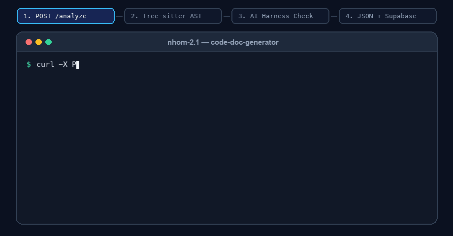
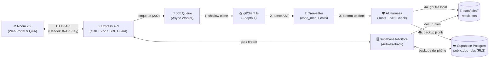

<div align="center">


# Code Documentation Generator

**Hệ thống đọc hiểu mã nguồn bằng Tree-sitter & AI Harness, tự động sinh tài liệu kỹ thuật kèm sơ đồ Mermaid và cung cấp qua HTTP API**

[](./tsconfig.json)
[](./package.json)
[](./src/api/routes.ts)
[](./src/parser/core.ts)
[](./supabase/schema.sql)
[](./src/api/schemas.ts)

[**Tổng quan**](#-tổng-quan) • [**Live Demo**](#-live-demo) • [**Kiến trúc**](#-kiến-trúc-hệ-thống) • [**Cài đặt nhanh**](#-cài-đặt--khởi-chạy-nhanh) • [**Đặc tả HTTP API**](#-giao-tiếp-http-api-nhóm-21--nhóm-22) • [**Cấu trúc dự án**](#-cấu-trúc-thư-mục-4-trụ-cột) • [**Kiểm thử**](#-kiểm-thử--postman)


</div>

## 🎯 Tổng quan

**Code Documentation Generator (Nhóm 2.1)** giải quyết bài toán tự động đọc hiểu các dự án phần mềm quy mô **30 – 100+ file** mà không bị vượt giới hạn ngữ cảnh (context window) của mô hình ngôn ngữ lớn, đồng thời **ngăn chặn ảo giác (hallucination)** bịa sai tên hàm và đảm bảo **sơ đồ Mermaid luôn vẽ thành công**.

Hệ thống vận hành theo nguyên tắc cốt lõi ***"Đo trước — Viết sau — Kiểm sau"*** và cung cấp kết quả qua **HTTP API bất đồng bộ** cho **Nhóm 2.2** *(Cổng xem tài liệu & hỏi đáp mã nguồn)*.

### 4 Trụ cột cốt lõi

| Trụ cột | Thư mục | Chức năng chính |
| :--- | :--- | :--- |
| **1. HTTP API & Hybrid Storage** | [`src/api/`](./src/api) · [`src/storage/`](./src/storage) | Cung cấp 2 REST API bất đồng bộ (`202 Accepted` $\rightarrow$ Polling `200 OK`), xác thực `X-API-Key`, chống SSRF, lưu kết quả tại `data/jobs/<id>/result.json` và tự động backup/fallback trên **Supabase (`jsonb`)**. |
| **2. Động cơ Tree-sitter** | [`src/parser/`](./src/parser) | Phân tích cú pháp AST đa ngôn ngữ (**TypeScript/TSX, Python, C#**) bằng `web-tree-sitter`, trích xuất chính xác danh sách hàm/lớp, tọa độ dòng (`start_line`, `end_line`) và đồ thị gọi hàm (`calls`). |
| **3. AI Harness & Self-Check** | [`src/ai_harness/`](./src/ai_harness) | Quản lý System Prompt theo phiên bản (`v1` $\rightarrow$ `v3`), ép đầu ra JSON Schema, cấp **3 công cụ tra cứu (Tool Calling)** và chạy vòng lặp tự đối chiếu tên hàm với `code_map` + tự sửa lỗi cú pháp Mermaid (tối đa 3 lần). |
| **4. Thực nghiệm & Đánh giá** | [`experiments/`](./experiments) · [`tests/`](./tests) | Đo lường thực nghiệm Phương án A vs. Phương án B trên các chỉ số: **Tỷ lệ ảo giác (%)**, **Tỷ lệ sơ đồ hiển thị thành công (%)** và **Mức tiết kiệm token khi cập nhật cục bộ (`changed_files`)**. |

---

## 🎬 Live Demo

<div align="center">
   Tree-sitter -> AI Harness -> 200 OK JSON" width="100%" />
  <p><em>Luồng xử lý bất đồng bộ: Nhận yêu cầu <code>POST /analyze</code> → Quét AST bằng Tree-sitter → Kiểm duyệt qua AI Harness → Trả JSON chuẩn & đồng bộ backup Supabase.</em></p>
</div>

---

## 🏗 Kiến trúc hệ thống



---

## 🚀 Cài đặt & Khởi chạy nhanh

### 1. Yêu cầu môi trường
- **Node.js** `>= 20.x` và **npm** `>= 10.x`
- **Git** CLI (phục vụ clone nông repository đầu vào)
- **Supabase Project** riêng của Nhóm 2.1 *(không dùng chung Database với Nhóm 2.2)*

### 2. Cài đặt thư viện & biến môi trường

```bash
# 1. Cài đặt toàn bộ dependencies
npm install

# 2. Tạo file cấu hình môi trường cá nhân
cp .env.example .env
```

### 3. Khởi tạo bảng trên Supabase
Mở **Supabase Dashboard $\rightarrow$ SQL Editor**, dán toàn bộ nội dung file [`supabase/schema.sql`](./supabase/schema.sql) và nhấn **Run** để khởi tạo bảng `public.doc_jobs` (đã kích hoạt sẵn **Row Level Security**).

### 4. Cấu hình file `.env`

| Biến môi trường | Bắt buộc | Mô tả |
| :--- | :---: | :--- |
| `PORT` | Không | Cổng chạy HTTP server (mặc định `3000`) |
| `API_KEY` | **Có** | Khóa bí mật xác thực header `X-API-Key` giữa Nhóm 2.1 và Nhóm 2.2 |
| `SUPABASE_URL` | **Có** | Project URL của Supabase (`https://<project-ref>.supabase.co`) |
| `SUPABASE_SERVICE_ROLE_KEY` | **Có** | Secret key (`sb_secret_...` hoặc `service_role`) chỉ dùng ở phía server |
| `LLM_PROVIDER` | Không | Nhà cung cấp mô hình cho AI Harness (`gemini` \| `openai` \| `mock`) |
| `LLM_MODEL` | Không | Tên model cố định phục vụ sinh tài liệu & thực nghiệm |
| `LLM_API_KEY` | Tùy chọn | API Key của dịch vụ Cloud LLM khi chạy chế độ thật |

### 5. Các lệnh chạy chính (`npm scripts`)

```bash
# Chạy HTTP API server ở chế độ phát triển (tự động reload khi lưu file)
npm run dev

# Chạy HTTP API server ở chế độ thường
npm start

# Kiểm tra chặt kiểu dữ liệu TypeScript toàn dự án (0 lỗi)
npm run typecheck

# Kiểm thử tự động toàn bộ 6 kịch bản HTTP API + lưu local + fallback Supabase
npm run test:api

# Kiểm thử đơn vị cho bộ kiểm soát AI Harness & Mermaid verifier
npm run test:harness

# Chạy thử bộ phân tích Tree-sitter trích xuất hàm & tọa độ dòng trên file mẫu
npm run parse:sample
```

---

## 🔌 Giao tiếp HTTP API (Nhóm 2.1 $\leftrightarrow$ Nhóm 2.2)

Tài liệu hợp đồng đầy đủ xem tại **[`doc/api-contract.md`](./doc/api-contract.md)**. Mọi endpoint dưới `/api/v1/docs/*` bắt buộc đính kèm header `X-API-Key`.

### 1. Gửi yêu cầu phân tích — `POST /api/v1/docs/analyze`

```bash
curl -i -X POST http://localhost:3000/api/v1/docs/analyze \
  -H "Content-Type: application/json" \
  -H "X-API-Key: <your_api_key>" \
  -d '{
    "repo_url": "https://github.com/LeMinhSang2k5/TodoAppCloud",
    "branch": "main",
    "commit_sha": "58629bb3d8713716511c1c59263c3f8c86816474",
    "changed_files": []
  }'
```

**Phản hồi ngay lập tức (`202 Accepted`):**
```json
{
  "job_id": "doc_job_1795539632750_8c0206",
  "status": "processing"
}
```

### 2. Truy vấn trạng thái & kết quả — `GET /api/v1/docs/jobs/:job_id`

```bash
curl -i http://localhost:3000/api/v1/docs/jobs/doc_job_1795539632750_8c0206 \
  -H "X-API-Key: <your_api_key>"
```

<details>
<summary><strong>Xem mẫu JSON phản hồi khi hoàn tất (<code>200 OK — status: "done"</code>)</strong></summary>

```json
{
  "job_id": "doc_job_2026_001",
  "status": "done",
  "commit_sha": "58629bb3d8713716511c1c59263c3f8c86816474",
  "code_map": [
    {
      "node_id": "fn_auth_service_login",
      "name": "AuthService.login",
      "file_path": "src/services/auth.service.ts",
      "start_line": 24,
      "end_line": 58,
      "calls": ["fn_user_repo_find_by_email", "fn_jwt_sign_token"]
    }
  ],
  "documents": [
    {
      "doc_id": "doc_auth_module",
      "title": "Xác thực người dùng (Auth Module)",
      "path": "modules/auth.md",
      "markdown": "## Luồng đăng nhập\n...",
      "mermaid_diagram": "sequenceDiagram\n  Client->>AuthController: login(email, password)",
      "source_node_ids": ["fn_auth_service_login"]
    }
  ]
}
```
</details>

### Bảng mã trạng thái HTTP

| Mã HTTP | Ý nghĩa | Cấu trúc trả về |
| :---: | :--- | :--- |
| `202` | Đã tiếp nhận job vào hàng đợi nền | `{ job_id, status: "processing" }` |
| `200` | Trạng thái hiện tại của job | `processing` \| `done` (`code_map` + `documents`) \| `failed` (`error`) |
| `400` | Dữ liệu đầu vào sai / URL vi phạm SSRF | `{ error: { code: "INVALID_INPUT", message } }` |
| `401` | Thiếu hoặc sai `X-API-Key` | `{ error: { code: "UNAUTHORIZED", message } }` |
| `404` | Không tìm thấy `job_id` | `{ error: { code: "JOB_NOT_FOUND", message } }` |

---

## 📂 Cấu trúc thư mục 4 trụ cột

```text
code-doc-generator/
├── doc/
│   ├── assets/                     # Logo SVG & ảnh động GIF minh họa pipeline
│   ├── http-api-cover.png          # Ảnh banner dự án
│   ├── api-contract.md             # Hợp đồng API chính thức với Nhóm 2.2
│   ├── ke-hoach-thuc-hien.pdf      # Tài liệu kế hoạch tổng thể 8 tuần
│   └── week1/http-api-plan.md      # Kế hoạch chi tiết Trụ cột 1 (Tuần 1)
├── supabase/
│   └── schema.sql                  # Schema bảng public.doc_jobs (jsonb + RLS)
├── src/
│   ├── index.ts                    # Entry point khởi chạy Express HTTP Server
│   ├── api/                        # [TRỤ CỘT 1] Xác thực, Zod Schema, Routes, Controller, JobQueue
│   ├── storage/                    # [TRỤ CỘT 1] Lưu JSON local + Backup/Fallback Supabase
│   ├── parser/                     # [TRỤ CỘT 2] Tree-sitter AST & Call Graph (TS / Python / C#)
│   ├── ai_harness/                 # [TRỤ CỘT 3] Prompts, Schema, 3 Tools, Self-Check Verifier
│   ├── data/sample-output.json     # Dữ liệu JSON mẫu chuẩn hợp đồng
│   ├── types/index.ts              # Hệ thống kiểu TypeScript dùng chung
│   └── utils/                      # Logger (tự che secret), File I/O, Git shallow clone
├── experiments/                    # Kịch bản khảo sát & đo lường thực nghiệm
└── tests/                          # Kiểm thử tự động API, Harness, Parser & Postman Collection
```

---

## 🧪 Kiểm thử & Postman

### 1. Bộ kiểm thử tự động (`npm run test:api`)
Thực thi [`tests/run-verify.ts`](./tests/run-verify.ts) kết hợp [`verify-api.sh`](./.agent/skills/week1-http-api-verify/scripts/verify-api.sh), tự động kiểm chứng:
- **TC1 / TC1b:** Chặn request thiếu hoặc sai `X-API-Key` (`401`).
- **TC2:** Chặn tấn công SSRF (`http://localhost`, IP nội bộ, domain lạ) và path traversal `..` (`400`).
- **TC3 $\rightarrow$ TC5:** Luồng bất đồng bộ `202 Accepted` $\rightarrow$ `200 processing` $\rightarrow$ `200 done` + đối chiếu toàn vẹn `source_node_ids` $\subseteq$ `code_map[].node_id`.
- **TC5b (Fault-tolerance):** Thử xóa file `data/jobs/<id>/result.json` trên ổ cứng và xác nhận API tự động khôi phục kết quả từ bản backup trên Supabase.
- **TC6:** Trả `404` cho `job_id` không tồn tại.

### 2. Kiểm thử trực quan bằng Postman
1. Mở Postman $\rightarrow$ bấm **Import** và nạp 2 file trong [`tests/`](./tests):
   - [`tests/postman_collection.json`](./tests/postman_collection.json)
   - [`tests/postman_environment.example.json`](./tests/postman_environment.example.json) *(hoặc bản `.local.json` trên máy cá nhân)*
2. Chọn môi trường **`Nhóm 2.1 - Local Dev`** ở góc trên bên phải Postman, điền `api_key` từ `.env` và bấm **Send** từ `TC1` đến `TC6` (`job_id` ở `TC3` sẽ tự động truyền sang `TC4 & TC5`).

---

## 🔒 Bảo mật & Độ tin cậy

- **Timing-Safe Auth:** So sánh `X-API-Key` bằng `crypto.timingSafeEqual` để chống timing attack.
- **Chống SSRF & Path Traversal:** Chỉ chấp nhận URL `https://github.com/<owner>/<repo>`; kiểm tra chặt `job_id` (`^[a-zA-Z0-9_-]+$`) và `changed_files` trước khi thao tác đĩa cứng.
- **Không thực thi mã lạ:** Chỉ đọc tĩnh mã nguồn bằng Tree-sitter, tuyệt đối không chạy `npm install` hay script bên trong repository đầu vào.
- **Bảo vệ khóa bí mật:** Logger tự động ẩn các trường nhạy cảm (`x-api-key`, `authorization`, `supabase_service_role_key`); bảng `doc_jobs` bật **Row Level Security (RLS)** chặn truy cập công khai.

---

## 🗺 Lộ trình phát triển (8 Tuần)

- [x] **Tuần 1:** Khởi tạo kiến trúc 4 trụ cột, chốt `api-contract.md` với Nhóm 2.2, hoàn thiện HTTP API + Supabase backup, đọc thử AST bằng Tree-sitter & khảo sát lỗi sơ đồ AI.
- [ ] **Tuần 2 – 3:** Hoàn thiện `code_map` chuẩn (đầy đủ tọa độ dòng & đồ thị gọi hàm `calls`) và luồng tổng hợp tài liệu theo tầng (hàm $\rightarrow$ module $\rightarrow$ kiến trúc).
- [ ] **Tuần 4 – 5 (Mốc MVP):** Tích hợp hoàn chỉnh AI Harness (`v1` $\rightarrow$ `v3`, Tool Calling, Self-Check Loop), xuất `preview.html` và bàn giao API chạy thật trên dự án 30–50 file.
- [ ] **Tuần 6:** Hoàn thiện cập nhật cục bộ theo `changed_files` và tích hợp end-to-end với Nhóm 2.2.
- [ ] **Tuần 7 – 8:** Thực nghiệm trên 3–5 dự án mã nguồn mở thật, thống kê 3 chỉ số đánh giá và hoàn thiện báo cáo.

---

<div align="center">
  <sub>Phát triển bởi <strong>Nhóm 2.1 — Code Documentation Generator</strong></sub>
</div>
