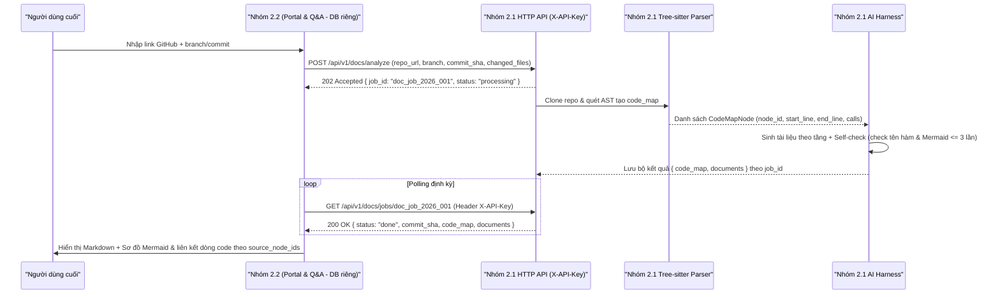

# Sơ đồ Luồng Dữ liệu Giao tiếp HTTP API giữa Nhóm 2.1 và Nhóm 2.2

Tài liệu dùng để thống nhất hợp đồng giao tiếp cuối Tuần 1 giữa **Nhóm 2.1 (Code Documentation Generator)** và **Nhóm 2.2 (Cổng xem tài liệu & Hỏi đáp mã nguồn)**.

## Thông tin bộ mẫu đã xuất kèm
- **Dự án mẫu:** `https://github.com/LeMinhSang2k5/TodoAppCloud`
- **Commit SHA:** `58629bb`
- **File JSON mẫu:** `experiments/results/sample_for_group_2_2.json`
