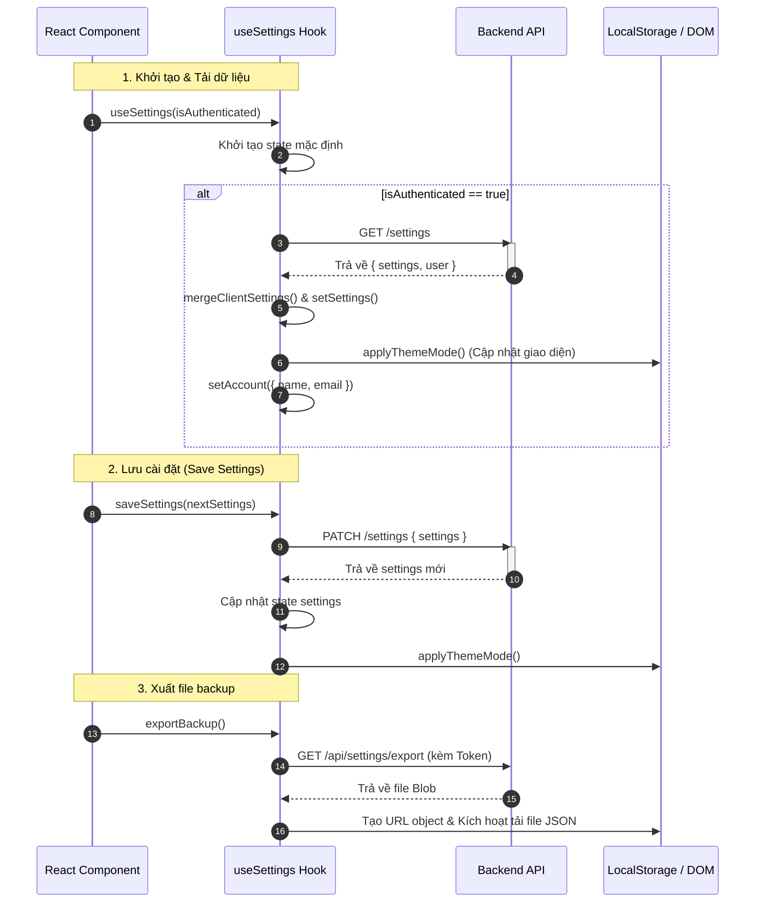
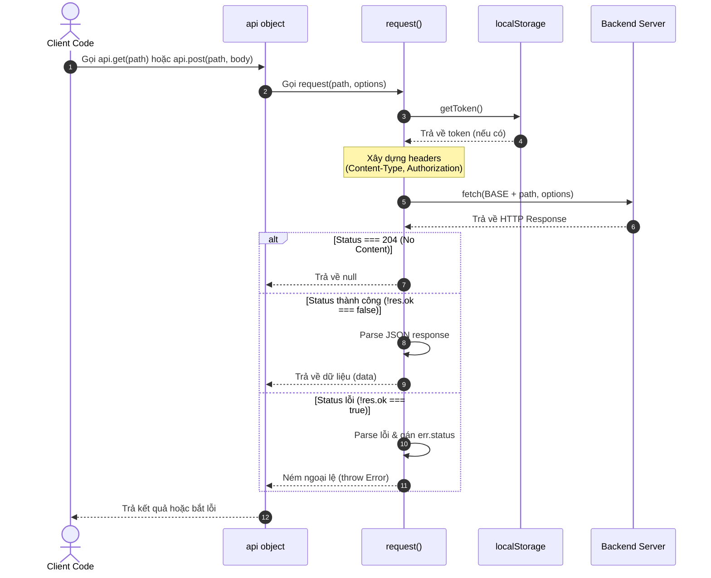
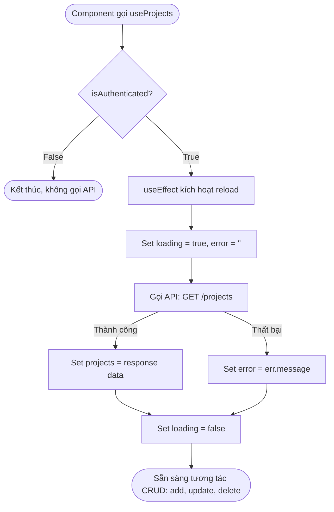

# Báo cáo Khảo sát Lỗi Sinh Tài liệu & Sơ đồ của AI — Tuần 1 (Nhóm 2.1)

## 1. Thông tin thực nghiệm khảo sát (Bản thô `v1` — Phương án A)
- **Nguồn dữ liệu khảo sát:** `https://github.com/LeMinhSang2k5/TodoAppCloud` *(đối chiếu với `code_map` quét bằng Tree-sitter và mã nguồn gốc của dự án)*
- **Provider / Model:** `gemini` / `gemini-flash-lite-latest`
- **Số file gửi rời rạc:** 4 file (không cung cấp `code_map` cho AI, không bật vòng tự kiểm tra)
- **Tổng lượng token tiêu thụ:** 6504 tokens (Prompt: 2923, Completion: 3581)
- **Tỷ lệ sơ đồ Mermaid hợp lệ ngay lần đầu:** **50%** (2/4 sơ đồ)
- **Tỷ lệ tên hàm nghi vấn AI tự bịa (Hallucination Rate):** **0%** (0/30 định danh hàm được nhắc tới)

## 2. Bảng thống kê chi tiết từng file

| STT | File khảo sát | Các hàm Tree-sitter quét được | Tên hàm ngoài `code_map` / bịa | Cú pháp Mermaid | Chi tiết lỗi ghi nhận | Kiểm tra trực quan |
| :---: | :--- | :--- | :--- | :---: | :--- | :---: |
| 1 | `src/hooks/useSettings.js` (98 dòng) | `useSettings`, `useSettings.reload`, `useSettings.saveSettings`, `useSettings.saveAccount`, `useSettings.exportBackup` | Không (0) | **Hợp lệ (Pass)** | Không lỗi | [Mở trên mermaid.live](https://mermaid.live/edit#pako:eNp9VD1v2zAQ_SsHDoENOA7abgISwHGCxo2TGJEMdPBCUxeLtUSq0slIYHjo1KFT5w5tEBToErRbAHlM0f_Bf1JQir-iJNpIvffu-N6RUya0j8xhKX7MUAk8kHyU8GigAAB4Rlpl0RCTch3zhKSQMVcE_Q7wFM6RC4K2jmKtUFEVdqT12AKzFF0kkmqUFntVZKtXKO5zMUbl22UV03UtpKsFD13SCR8h7MDB2clAldhTTQh6ggn0O42ijgOvmnAcmPl3CWTyaw1b4Jn8RoJv5r8hlGb-OSvJ_c723l7JWeu2JtNWRgEqkoIT-vUSbHFL-IZ-SpwQIpPfCfj71cy_qKCkPHgaEjyShN1doCTDErCm3up1HHh76MFO-tDNCsIFyYmttDTKfq1eZ3vZlpeY_AYmZv4JprBQaNjDJTBbcXx8WmvjiBEmI2yHEhUtnanDlpVdrSvcrusAj-PwygswwhPtY60OtbbJb2NQgclvCUaSa_BtDKr-TO0UqSWEzhTVpqB4hA3AiMsQZg8MVP5LE_C6Cd1_fzIQ9z-kjSS_I6i5fIKwaL1emYCUT1YjoPCSHkHXE-q1vPbRKqM1sxc2Vw1-LqglMzLzb7LEPhXQhkEbhpbztzkwL8TxknFvmvA-M_lPggsZIgy5GGdxxSq8jHVC-8XP2hP2FAPMY7k0aKdkQG18_ysCT49xEf1zrhTl90M9rBzHK-5c_7wLevgBBcEWHN_figACbfJrsnfyRpb8d-7ZKWuwCJOIS585bDpgZI0YMGfAfLzgWUgDNmMNZh8-90oJ5th72WBZ7HNavI2bm4e-JJ2Ue7P_Wf7XqQ) |
| 2 | `src/api/client.js` (63 dòng) | `getToken`, `request`, `api.get`, `api.post`, `api.patch`, `api.delete`, `saveAuth`, `clearAuth`, `loadSavedAuth` | Không (0) | **Lỗi cú pháp (Fail)** | Dòng 5: Khai báo participant chứa dấu () nhưng chưa bọc ngoặc kép: "participant Req as request()". | [Mở trên mermaid.live](https://mermaid.live/edit#pako:eNp9lDGP0zAUx7_KwwNKRXsgxBRxkXrlBMdQqrYDQxc3fk1MUzu1Xw6V0w1MNzGzcjAxnRBISM1wQz9Jvgly40gtrW6J7Jf_-7_fs598xWItkIXM4rJAFeMryRPDFxMFAMAL0qpYTNH4fUzaQC-TqAi4bVY9LbAW5NyQjGXOFUF3cOE0PJegpx8wpkPJEJdOYlxtS0HrUDEibXiCTpXpmGd-f0SI5hKN053xeI5K-MhE1doatRNF3cFFCK-r8ot0aCcJUpBzSluQ6mr9N94Gc23raBumWqw8V3dw0YmiIS6b_Ia7VuqcpFbWi4e47ESRxw0hQRrrOaqmR_-j0xiOTbX-AZdV-RnI6SBQ1fq-gHjz22fU374mBO063aa933xfgajKXyqBFLlAY19OzdMo6GlFrt_xKsc2dAtKtZGfuCPc8_OY26MKYYYUp8FZd3QOT-BYV7XwGPWb8XgAQ7S5VhZ3K_DM3SKnwsLp6Sk8f_YCgr4GD-h9G5TmfnaMVZFltQgzi40VpZtvKoV480clEDwyaE_0fFtgxjOL_9l63AE3FuHt6F0fzB7pA-VFVd5BJqvypoBAcOKtQ5isKr_KfQoyxYMQdcpjSDa3CtCYE7u1Oo7T3_xcgEp0tb6VLvMGAkqN_gjnxmjTACmxe-xuWDtRVI9909G8Wt8TLAu39uM-rdZ3VOOwNlugWXApWMiuJoxSXOCEhRMmcMaLjCbsmrWZexRGKxWz0DXZZkUuODXvxn7wXEjSpo5d_wNwWIw0) |
| 3 | `src/hooks/useTasks.js` (52 dòng) | `useTasks`, `useTasks.reload`, `useTasks.addTask`, `useTasks.toggleTask`, `useTasks.updateTask`, `useTasks.deleteTask` | Không (0) | **Lỗi cú pháp (Fail)** | Dòng 16: Tiêu đề subgraph chứa dấu ngoặc tròn () nhưng chưa bọc trong ngoặc kép "..." ("subgraph Action Flow (ví dụ: addTask)"). | [Mở trên mermaid.live](https://mermaid.live/edit#pako:eNp9kr9u2zAQxl_lwCFpAbvZDbiF_8d14gS1MhRSBkY8S0Ql0qAoB62RIQ9QIJ26OjDSoWi3TvKovAjfpNAlgV2nLUfy-93d9_EWLNQCWYNNE30ZxtxY8LqBAgDI8ovI8FkMQyWt5In8xK3U6uGxOi2_o9OZVqgsRG79WUKeocezD9k51Ouvob2QWSu3MSorQ25RvLnawG2o12GsSdjxR3H5S0WQlMsUovIHHIBnXLGCuVtfQ2a5RTBu_VVF5zsV3mNGJbp-nmFvOsXwaRaDiebiUY9KBGrH1jsSQD_Rl5uiXarW8ydooXqWKoImWJNjDdAYbaAJ-_tbU_QI6Put0yEMeh4cWApgI-hXY3pxuVQxhOSyAgbUgbTQBMEtf4644s7ChStuJSGHhDwNgca8SjHLeIRb5AD24JDUwx0LU55k-J80WmH1uZQGvJiXP0G49V0DuBDVj77ctHjrDyjfxxfy0K3mp7YjCuL0ZPKXJEakOFpUpG5ra3W6vRFH5NrkSLJj34vL7ymVh3m51NA5c-ubIaSuWKkIdosT3a9MEj5-ht_fuOLb2b_wY9iDMZEn_tbqEX7_pVyBdcWt3uTHaixFk3IpWIMtAmZjTDFgjYAJnPI8sQG7YjXGc6snH1XIGrRCLJ8JbrEreWR4-udlT0irzcPd1W9YfTIK) |
| 4 | `src/hooks/useProjects.js` (46 dòng) | `useProjects`, `useProjects.reload`, `useProjects.addProject`, `useProjects.updateProject`, `useProjects.deleteProject` | Không (0) | **Hợp lệ (Pass)** | Không lỗi | [Mở trên mermaid.live](https://mermaid.live/edit#pako:eNpdkL1u2zAQgF_lwCU2ILe7AKdwLNlxswS1M0keWPIkqpFIgzyhKAw_Qt4hHjIGyJAsypBBgN9Db1KYsoGm0-EO33d_WyaMRBayrDS_heKWYBWlGgBgMkimptoYjZog794fCqgd3lrzCwW59RBGo0u42hZuUpNCTYXghPLbrrevYDSCGS8dem46SG665oOAVNuIAO5V-6rzU9vJ7WI9_Edb2bq3oqR2GGcZCoL79lkoUKZr9gQWS8Plunciz8bJEgmO5ULnMAayNQaA1hoLY7i4OMGxh2fJ_Dw5hHm8gq-b8109NvN7qPZRKxB-1aM29zPOKIzBotsY7RAkJ_5Z7Zongp9dsy-8eu3V8zpo7ZcKneM5nqy5pxb_HZEdH3girnuiTxY--T5Ill3zpsG1jzoHOrwc9sfY7gVMf9xFIXApA6g3khMGILFEwvWQBaxCW_FCspBtU0YKK0xZmDKJGa9LStmOBYzXZJZ_tGCh_yXr20QFzy2vPhdjWZCxfW33F6Tbyow) |

## 3. Mã sơ đồ Mermaid gốc của từng file (Copy dán vào mermaid.live hoặc bấm Ctrl+Shift+V xem trực tiếp)

### Sơ đồ 1 — `src/hooks/useSettings.js` (Hợp lệ)



### Sơ đồ 2 — `src/api/client.js` (Lỗi cú pháp)



### Sơ đồ 3 — `src/hooks/useTasks.js` (Lỗi cú pháp)

```mermaid
flowchart TD
    subgraph Initialization
        A[Component gọi useTasks] --> B{isAuthenticated?}
        B -- No --> C[Không làm gì / Trả về state rỗng]
        B -- Yes --> D[useEffect gọi reload]
    end

    subgraph Reload Flow
        D --> E[Set loading = true, error = '']
        E --> F[API GET /tasks]
        F -- Thành công --> G[Set tasks = data]
        F -- Thất bại --> H[Set error = err.message]
        G & H --> I[Set loading = false]
    end

    subgraph Action Flow (ví dụ: addTask)
        J[Gọi addTask taskData] --> K[API POST /tasks]
        K --> L{addToBottom?}
        L -- True --> M[Thêm task vào CUỐI mảng tasks]
        L -- False --> N[Thêm task vào ĐẦU mảng tasks]
        M & N --> O[Trả về task đã tạo]
    end
```

### Sơ đồ 4 — `src/hooks/useProjects.js` (Hợp lệ)



## 4. Nhận xét, Giới hạn thực tế & Định hướng AI Harness (Tuần 2–5)
1. **Kết quả kiểm tra cú pháp Mermaid:**
   - Có **2/4 sơ đồ** mắc lỗi cú pháp ngay lần đầu:
     - `src/api/client.js`: Dòng 5: Khai báo participant chứa dấu () nhưng chưa bọc ngoặc kép: "participant Req as request()".
     - `src/hooks/useTasks.js`: Dòng 16: Tiêu đề subgraph chứa dấu ngoặc tròn () nhưng chưa bọc trong ngoặc kép "..." ("subgraph Action Flow (ví dụ: addTask)").
   - *Giới hạn hiện tại:* Hàm `kiem_tra_cu_phap_so_do` trong `src/ai_harness/tools/checkMermaid.ts` đang kiểm tra cú pháp bằng **Regex + Stack thủ công** chứ chưa dùng parser Mermaid chính thức (`mermaid.parse()`), nên vẫn có khả năng bỏ sót một số lỗi cú pháp hiếm.
2. **Phát hiện thực nghiệm về đối chiếu tên hàm & False Positive (PR #6):**
   - Khi bật đối chiếu đầy đủ với `code_map` nâng cấp và mã nguồn gốc `file.content` (sau PR #6), tỷ lệ nghi vấn bịa đặt giảm còn **0% (0/30)** — loại bỏ hoàn toàn tình trạng báo động giả (false positive 68.42% ở bản sơ khai với hàm con `useCallback` và method của `export const api`).
   - *Bài học từ Tuần 1:* Ở bản khảo sát sơ khai (trước PR #6), bộ đếm từng báo 68.42% định danh ngoài `code_map` do Tree-sitter đời đầu chưa tách hàm `useCallback` và method của object `api`. Từ phát hiện đó, nhóm đã nâng cấp parser (`src/parser/languages/typescript.ts`) và truyền mã nguồn gốc vào `verifyDocument` (`appearsInSourceCode` + `normalizeVerifiedExternalBackticks`) để loại bỏ báo nhầm.
3. **Kiến trúc AI Harness (`v2 -> v3`) & Hướng cải tiến Tuần 2:**
   - Đã khóa cấu trúc JSON đầu ra qua `AIDocumentOutputSchema` (`specs: [{ key, value }]`, `markdown`, `mermaid_diagram`, `source_node_ids`), kết hợp 3 công cụ (`doc_ma_nguon_ham`, `xem_ham_lien_quan`, `kiem_tra_cu_phap_so_do`) và vòng tự sửa tối đa 3 lần (`maxRetries = 3`).
   - *Các giới hạn cần xử lý tiếp ở Tuần 2:*
     - `verifyDocument` mới kiểm tra tĩnh các định danh bọc backtick; chưa tự kiểm tra được sai sót về logic nghiệp vụ (ví dụ mô tả ngược điều kiện boolean) hoặc hàm bịa không bọc backtick.
     - Đồng bộ ID nút trong `mermaid_diagram` trùng khớp với `node_id` trong `code_map` để hỗ trợ Nhóm 2.2 bấm vào sơ đồ nhảy tới đúng dòng code.
     - Bổ sung kiểm tra chặn Path Traversal trong `src/ai_harness/tools/readSource.ts` và cơ chế retry `429` cho nhánh `generateOpenAI` (OpenRouter).
