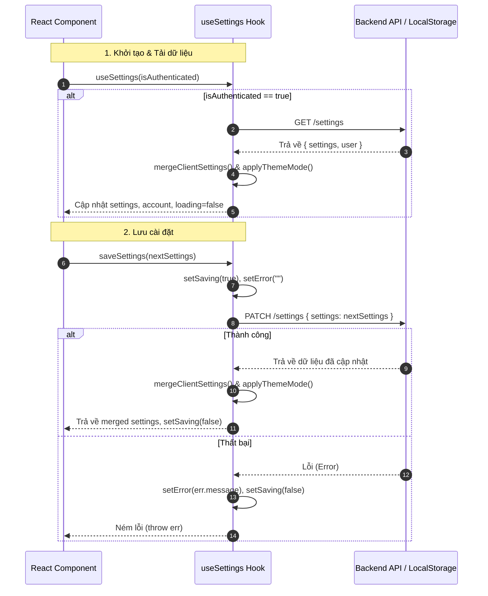
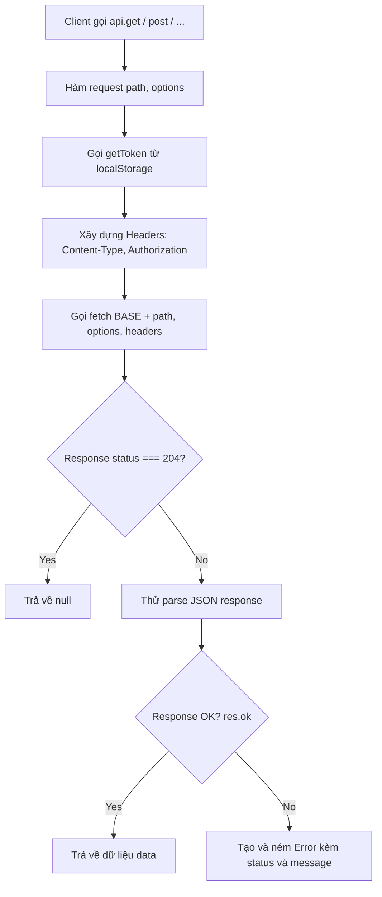
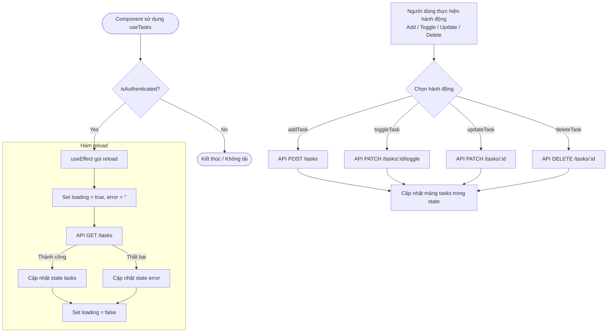
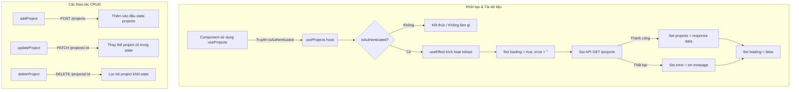

# Báo cáo Khảo sát Lỗi Sinh Tài liệu & Sơ đồ của AI — Tuần 1 (Nhóm 2.1)

## 1. Thông tin thực nghiệm khảo sát (Bản thô `v1` — Phương án A)
- **Nguồn dữ liệu khảo sát:** `https://github.com/LeMinhSang2k5/TodoAppCloud` *(đối chiếu với `code_map` quét bằng Tree-sitter thật của nhóm)*
- **Provider / Model:** `gemini` / `gemini-flash-lite-latest`
- **Số file gửi rời rạc:** 4 file (không cung cấp `code_map` cho AI, không bật vòng tự kiểm tra)
- **Tổng lượng token tiêu thụ:** 6131 tokens (Prompt: 2619, Completion: 3512)
- **Tỷ lệ sơ đồ Mermaid hợp lệ ngay lần đầu:** **100%** (4/4 sơ đồ)
- **Tỷ lệ tên hàm nghi vấn AI tự bịa (Hallucination Rate):** **68.42%** (13/19 định danh hàm được nhắc tới)

## 2. Bảng thống kê chi tiết từng file

| STT | File khảo sát | Các hàm Tree-sitter quét được | Tên hàm ngoài `code_map` / bịa | Cú pháp Mermaid | Chi tiết lỗi ghi nhận | Kiểm tra trực quan |
| :---: | :--- | :--- | :--- | :---: | :--- | :---: |
| 1 | `src/hooks/useSettings.js` (98 dòng) | `useSettings` | Có (`reload`, `saveSettings`, `saveAccount`, `exportBackup`) | **Hợp lệ (Pass)** | Không lỗi | [Mở trên mermaid.live](https://mermaid.live/edit#pako:eNq1VD2P00AQ_SujLVAs-XKC0lJOCiHiToTTiSSdm731XLw6e9es14FTlIKKmoqSO50oKBAUSEhJGcT_8D9h_HGJkyhQ4cb27Myb997s7owJHSDzWIqvM1QCn0k-MTz2FdDDM6tVFl-iqf4TbqwUMuHKwvgMeAqvkAsLPR0nWqGy-2mnWl8XiVmKQ7RWqklaxvYzuxcl4lMurlEF5e8xDLTg0dBqwyfoq6roXFsEPUVDHNwSzIPHbXgR5stPEmy-uNPwCEb54l5CkC-_QSTz5fusKh6fHZ2cVDUNSi2ZdjMbkgIpuMXAqfVHFnZWoNMBazKsEoqnACNM4uvB8_4IjtMadJNCa0frtiNDzGCaL9_BDB5y3YKNgfkebFUTo5lgL5JEY03ZIZE8SaKbUYgxvqQxtpydcqofE6tevviagArpZRsduRA6U9aFSPOAQp0rHqW1MJrA3-x-0obB7-8ZiNWthF8f8sVPu2dvyqcbfxW-XTOvWW4JJFZDPqXVVmGu4xaBvjHatHzms-2K0umL7qh3uvG6YaUHzWYPlhajHIWrWxUS6R9q8u_hNLYOSVzdg2jY-F_m1GheAgWNYW0MKqdUIyB9kqx88dnCJW18eUDWIF9-lNAqHXUOcF87jsa0Y0xTOnLOoca71M9XX2KIqi42NPoNEIqz3kvMZaQo5jKgq2bmM1tY4TPPZwFe8SyyPptTTnHfDG-UYF6xC1yWJQGdufpK2g72A0m3QhWb_wGBzKm0) |
| 2 | `src/api/client.js` (63 dòng) | `getToken`, `request`, `saveAuth`, `clearAuth`, `loadSavedAuth` | Có (`get`, `delete`) | **Hợp lệ (Pass)** | Không lỗi | [Mở trên mermaid.live](https://mermaid.live/edit#pako:eNpVkstO3DAUhl_lyFsyoapYjTRFcwkMIIHEZAFKZmElZxJrEjv4QjWMZsGKFe8AdNOqqqpuyTJPkjepc6k6eGPJ5_v___jYWxKJGMmQrDLxNUqp1ODPQg52jYNpxpBrSOrymQEtmJughkMohGo213WXMBh8gUkwr15ykHhn0FYKqlMHRKGZ4GrZeU1acBqctlbWxhdr5KDr8idkIqLZQgtJE-zxaYvPgpvqbQNxXf7hCcyRxijVEKaCa9vWwN8U6MDY6FRI9kCbuF4-a-Ven7ZCHaUwGS88OPjYnANpZ9rrvFZ3sr1GVdgygtJUGwWj0Qg-fzo63nXYicXgFlVLnwa-rN-_wX1dPgI3Wbbcgy5Fy8wDP63LXzZcWtPzxdWlHVYX0dPzljv7n3x1cdwwrlj3oWf7oef7oXY-vyFjdflkIKaaLvcEfQMXgV-_vwq4r16AVz9y8KQUEtbV9_zfHZtSjko1j0AckqPMKYvtx9iGRKeYY0iGIYlxRU2mQ7KzDDVaLDY8IkMtDTrEFDYeZ4wmkuYfD72Y2QfuznZ_ATew2fo) |
| 3 | `src/hooks/useTasks.js` (52 dòng) | `useTasks` | Có (`reload`, `addTask`, `toggleTask`, `deleteTask`) | **Hợp lệ (Pass)** | Không lỗi | [Mở trên mermaid.live](https://mermaid.live/edit#pako:eNp9VEFr2zAU_isPX9pCi-9h6wiJt4yWrizuYdg5KJZii9pSkGXGSHLeqYcddxh0jB4LG_RS-7BDxv6H_slkyXVmk81g-1l636f3fU_yyok4Js7AWaT8fZQgIcEfhwz0NZX66zAY8WzJGWESclXdA1bVHYuhyImP8ut8dgQnJ6cwSkh0PSxksqJ5_dLpNEKS4BcbS2afbVoNWl_wNXgMHwZnqvwpQSbbMgIXzpLtg15BqvIbnR3tA74j-Rp8QeOYCG-xIJEMdD02glhVNxQESTnCs5BZfF7MY4GWSTMOwWR7m-2SoLk6nEbYlMhznUNZHOgQUhvDc5CiIMdAhOBCfx0c_MWyw1hvUJoOL18H-oZXng-uNMbt8psEI81Ptrcsgai2YF0zGZeDkSrvl8AS_dJ9kNpZ-D-LKu8kzFX5lRoWr65zH4sR0K3drGgqf0kZSnu6FyjNSRdgyHcAO0cYfjL_KidiGEnKWXAR__6uqi8U8Pax7nGiqh8RJFRVHxlY6b8-qeozi5_NhXs6xFhvCJ_HcUp0cLXEdc0ujElKJJmZNd8WbIIYTolYjTTdTY9n81TFLs9YhDCuha5Be6aXMd25fDPttacHkqaSFmcLs9ChP5o0WHdAsWtT99MURkdLY2XtpdmPx0Z-i7duGPzYO_d8r0tgKaxM45hdb1r3v7slMn3k6q6YDSAF17HZJbOWomlFj6Wdbhr0r2lbaH_aOXYyIjJEsf4NrUJH_z0yEjqD0MFkgYpUhs5G56BC8ukHFjkDc_Qca-KYIn2ws-6gh6nkwo5t_gAiAbpI) |
| 4 | `src/hooks/useProjects.js` (46 dòng) | `useProjects` | Có (`reload`, `addProject`, `deleteProject`) | **Hợp lệ (Pass)** | Không lỗi | [Mở trên mermaid.live](https://mermaid.live/edit#pako:eNptU8Fu00AU_JUnHyhILblHApQ6bhISSETMyc5ha2_iJbY32l2DQp1DT5xQxReQClUIRMUBTvaBg-FD_Cc824Q4Vn2xvTszO2_e2wvN4S7V2trc528cjwgFZtcOAR8ZnS8EWXkwCJlixGdviWI8BGvo5elHBipPrjncAzNPPjFw8_Q7-CxP30Wzil88HUvnwYqHNFQg8_S2gN2EC4gknQj-ijpKzuDk5HFsimidp5chMNmJlId45hBF3RhO79fA4HG-fLDXPy3IoF80WE82e4he6g-97Ge4iKFrDfPklwLlZYkDLajWwc-2ASyyb7MmT89-xGBYaMGYz9EBLLNbx0MbWLwCQX1O3BrJKP2cWVOqoNhiqP0IlIjoMVAhuMC_o6Ma4awk9Kxenr5n0JkMoGeY0Frtwtkje1VOXrYNPXCqavrlQTswagsqMW1JwSWK3EHOkxsF5-idxTAoyTtX-H4YUCnJgtZ4fezvoLT4tFHTnPhyh6Sha4eNodFfvOzCeEVFOTQSLD27djB2wkEVX8V-7aChRVz3X5eriZiMp7UgYhhZWPvXAF5nWw6_P-TJ5wikwm7DHWE9s6IVRkAPFTum3t9LttoMx-s5ypI1GsOx2CmB8-cLNo1joeUJNeGx5VKfNoS7xsgwjabyxBphUx2MO736r7zEu3PFDmQxPe1YC6gICHPxJl7YGo5yQG2tbWsunZPIV7a2QQyJFJ-uQ0drlxOlVTV2GcHIg8NFw2WKi2pt8xd3xWBI) |

## 3. Mã sơ đồ Mermaid gốc của từng file (Copy dán vào mermaid.live hoặc bấm Ctrl+Shift+V xem trực tiếp)

### Sơ đồ 1 — `src/hooks/useSettings.js` (Hợp lệ)

### Sơ đồ 2 — `src/api/client.js` (Hợp lệ)

### Sơ đồ 3 — `src/hooks/useTasks.js` (Hợp lệ)

### Sơ đồ 4 — `src/hooks/useProjects.js` (Hợp lệ)

## 4. Nhận xét & Định hướng thiết kế AI Harness (Tuần 2–5)
1. **Nhóm lỗi cú pháp Mermaid phổ biến khi chạy bản thô `v1`:**
   - AI thường đặt dấu ngoặc tròn `()` trực tiếp bên trong nhãn `[]`, tiêu đề `subgraph` hoặc alias `participant` mà quên bọc trong dấu ngoặc kép `"..."`, làm trình biên dịch Mermaid gãy cú pháp.
   - AI hay nhầm lẫn cú pháp mũi tên giữa `sequenceDiagram` (`A --> B: nhãn`) và `flowchart TD` (`A -->|"nhãn"| B`).
2. **Nhóm lỗi ảo giác (Hallucination) khi gửi từng file rời rạc:**
   - Khi thiếu `code_map` liên kết toàn cục, AI tự đoán thêm tên hàm phụ trợ ở các module khác không tồn tại trong `code_map`.
3. **Giải pháp khắc phục trong AI Harness (`v2 -> v3`):**
   - Khóa đầu ra bằng `AIDocumentOutputSchema` (Zod) và truyền danh sách `code_map` từ Tree-sitter vào `system_prompt_v2.txt`.
   - Sử dụng `verifier.ts` + `kiem_tra_cu_phap_so_do` tự động đối chiếu tên hàm với `code_map` và gửi thông báo lỗi cú pháp Mermaid bắt AI tự sửa (tối đa 3 lần).
